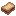
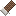
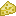

# VoxeLibre More Food mod [mcl_morefood]
This mod adds five more food items to VoxeLibre (ex. MineClone2) or Mineclonia!

## Items
*  Sandwich
*  Chocolate bar
*  Fried egg
*  Cheese
*  Sweet Berry Pie

## Media sources
- Chocolate bar texture uses cocoa bean and iron ingot colors from PixelPerfection by XSSheep
- Cheese texture is from Mobs Animal by Krupnov Pavel (slighty edited by me)
- Fried egg texture was made by @bramaudi
- Sandwich texture was made by @bramaudi
- Sweet Berry Pie texture uses pumpkin pie texture from PixelPerfection by XSSheep
